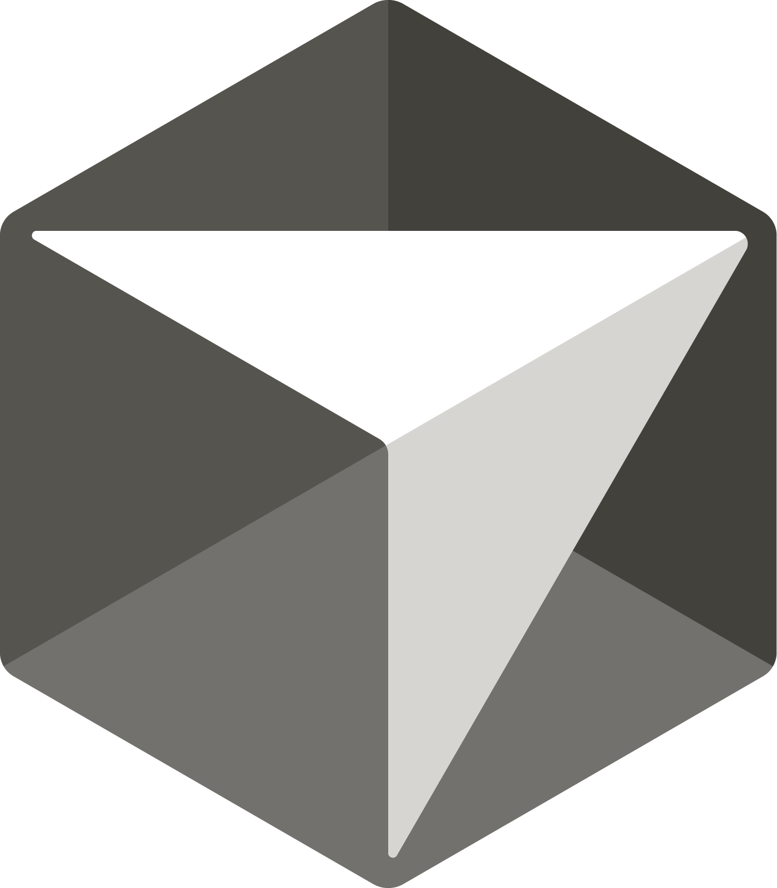

# Gabriel Mitsuru Kameoka Namazu
### Desenvolvedor Full-stack .NET & Angular

Sou um **Engenheiro de Software** com foco em desenvolvimento de soluções escaláveis com **.NET** e **Angular** integrando IA no desenvolvimento. Tenho base sólida em lógica de programação e arquitetura de sistemas, buscando gerar impacto em produtos de qualidade, moderno e principalmente, escalável para milhares de pessoas.

- Portfólio: [gabrielmitsuru.com](https://gabrielmitsuru.com)
- Email: [gabrielkameoka@gmail.com](mailto:gabrielkameoka@gmail.com)
- WhatsApp: https://wa.me/+5511964449982
- LinkedIn: [in/gabriel-mitsuru](https://www.linkedin.com/in/gabriel-mitsuru)

## Experiência e Projetos

### Pet'sFran Agendamento — (dez/2025 - mar/2026)
**Stack:** `.NET 9`, `Angular`, `Docker`, `PostgreSQL`
- Desenvolvimento de aplicação comercial full-stack ponta a ponta voltada para gestão de pet shops.
- Criação de API RESTful desacoplada com autenticação e segurança baseada em tokens JWT.
- Persistência otimizada com PostgreSQL e conteinerização total do ambiente com Docker.
- Deploy automatizado em nuvem utilizando Railway e Vercel.

### RepCortex — (mar/2026 - jul/2026)
**Stack:** `.NET 9`, `Angular 17+`, `SignalR`, `SQL Server`, `ML.NET`
- Solução SaaS Multi-Tenant inteligente para ingestão, moderação e gerenciamento de feedbacks baseada em Inteligência Artificial.
- Integração de modelos do ML.NET no backend para análise automatizada de sentimento e identificação de fraudes/antispam (fingerprint).
- Arquitetura de streaming em tempo real com barramento SignalR para atualização instantânea de dashboards analíticos.
- Interface reativa de alta performance construída em Angular utilizando reatividade moderna com Signals e Effects.

### Aprenda+ — (mar/2024 - jul/2024)
**Stack:** `HTML`, `CSS`, `JavaScript`
- Projeto educacional em grupo desenvolvido durante o curso do Instituto da Oportunidade Social (IOS).
- Trabalho focado em fundamentos de desenvolvimento web e apresentado na sede da TOTVS como conclusão do curso.

## Formação
- **CST em Análise e Desenvolvimento de Sistemas**
- **Descomplica Faculdade** (`ago/2024 - dez/2026`)

## Habilidades e Competências
- **Backend:** `C#`, `.NET 7/8/9`, `ASP.NET Core`, `CQRS`, `SignalR`, `ML.NET`
- **Frontend:** `Angular 16/17+ (Signals/Effects)`, `TypeScript`, `JavaScript`, `HTML5`, `CSS3`
- **Banco de dados & Cache:** `SQL Server`, `PostgreSQL`, `Redis`
- **Ferramentas & Infra:** `Git`, `Docker`, `CI/CD (Railway/Vercel)`
- **Qualidade & Arquitetura:** `xUnit`, `Clean Architecture`, `SOLID`, `Design Patterns`, `System Design`
- **Metodologias:** `Scrum`, `Kanban`
- **Interesses:** Segurança da Informação, Engenharia de Dados e Sistemas Financeiros

## Tecnologias e Ferramentas
<table>
  <tr>
    <td></td>
    <td></td>
    <td></td>
    <td></td>
    <td></td>
    <td></td>
    <td></td>
  </tr>
</table>
